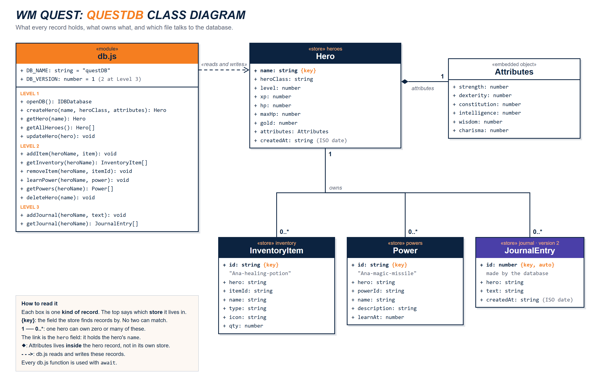

# WM Quest: IndexedDB Save Data

West-MEC Coding Year 2. The game is already built: roll your stats and place them, fight monsters with attacks, spells, skills, and items, grab the loot, and level up.
**But nothing saves.** Your job is the save data: every hero, their attributes, powers, and inventory go into **IndexedDB**.

Your packet's **DATA SPEC** tells you WHAT to save and what to name it. HOW is up to you.

## The data at a glance

Every store, every field, and who owns what. Your packet's DATA SPEC has the details.



## Setup

1. Open the terminal: **PowerShell**, **Git Bash**, or **Command Prompt** (any one works).
2. Move into your code folder on the Desktop (use your folder's real name):

   ```
   cd Desktop
   cd code
   ```

   Desktop not found? It may be inside OneDrive: `cd OneDrive`, then `cd Desktop`.

3. Clone the game:

   ```
   git clone https://github.com/Xerrath/indexeddb-quest-starter.git
   ```

4. Open **VS Code** > **File > Open Folder** > Desktop > your code folder > `indexeddb-quest-starter` > **Select Folder**.
5. Right-click `index.html` > **Open with Live Server**. Use **Chrome**.

You should see a gray line that says `openDB() is not built yet (Level 1)`. That's right: you build it.

## The files

| File | What it is | Do you change it? |
| --- | --- | --- |
| `index.html` | The page. | No |
| `global.css` | All the styling. | No |
| `data.js` | The rules: classes, powers, items, monsters, `modifier()`. | No (read it!) |
| `db.js` | **Every** IndexedDB function. | **Yes: this is your file** |
| `game.js` | Runs the game and calls the functions in `db.js`. | No (read it!) |
| `check.js` | The **Spec Check** panel. Compares your data with the spec. | No |

## See your database

Chrome DevTools (F12) > **Application** tab > **Storage** > **IndexedDB** > `questDB`.
Click the refresh icon above the table after you change data.

Or press **Check my data** on the main menu.

## Start over

DevTools > **Application** > **Storage** > **Clear site data**, then refresh the page.

## Stuck?

- **Nothing changes after I edit db.js**: save the file (Ctrl+S). Live Server reloads by itself.
- **The page hangs after I change DB_VERSION**: close every other tab that has the game open, then refresh.
- **A box on my hero sheet says missing!**: the field name in your record doesn't match the spec. Press **Check my data**.
